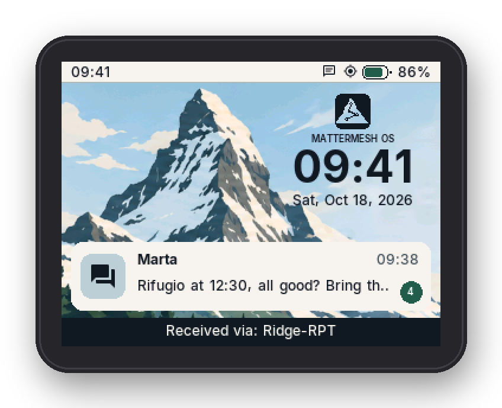
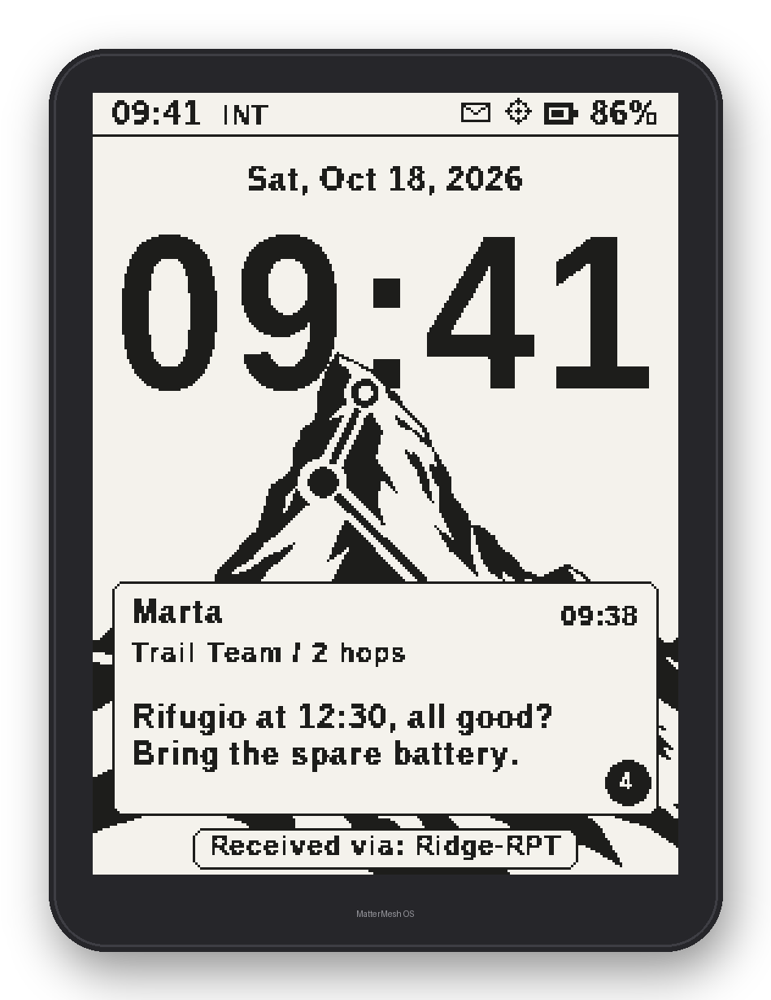
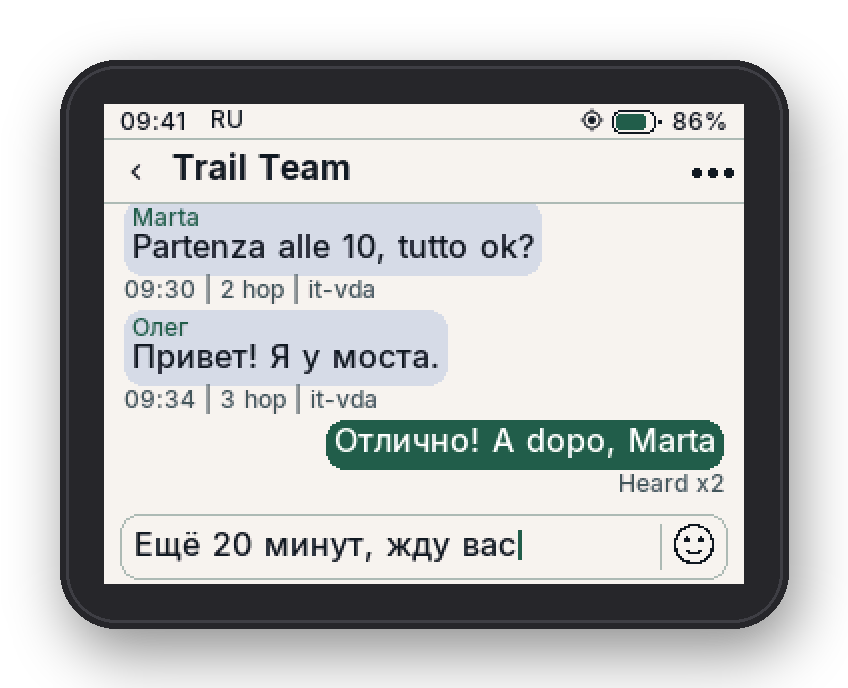
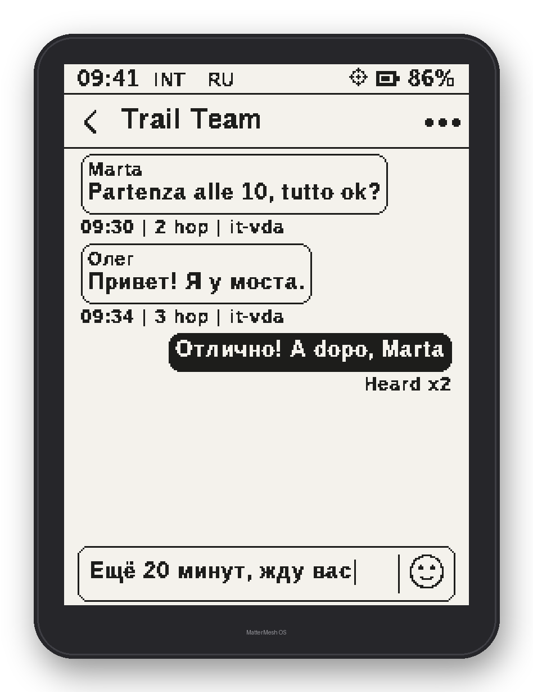

# MatterMesh OS

An alternative firmware for the LilyGO **T-Deck Plus** and **T-Deck Max**, built on [MeshCore](https://github.com/meshcore-dev/MeshCore):
off-grid LoRa chat with a real keyboard, designed for use in the field.

**Website and browser installer: [mattermeshos.com](https://mattermeshos.com)** — install it on your T-Deck from Chrome or Edge, no tools needed.

<table>
<tr>
<td align="center"><br><b>T-Deck Plus</b> · lock screen</td>
<td align="center"><br><b>T-Deck Max</b> · lock screen</td>
</tr>
<tr>
<td align="center"><br>Chat in two languages (Plus)</td>
<td align="center"><br>Chat in two languages (Max)</td>
</tr>
</table>

This repository holds the source of the **Free edition**, released under the GNU General Public License v3.0.

| Folder | Device | Display |
|---|---|---|
| [`tdeck-plus/`](tdeck-plus) | T-Deck Plus (ESP32-S3, SX1262) | 320×240 colour LCD, touch |
| [`tdeck-max/`](tdeck-max) | T-Deck Max (ESP32-S3, SX1262) | 240×320 e-paper, touch |

The two devices are separate code bases (different screens, input and power management); they share the
MeshCore companion protocol, so they work with the MeshCore apps and with every other MeshCore node.

## What's in the Free edition

- Channel and direct chats, contacts, emoji, mentions and quick replies; themes and lock screens (Plus), wallpapers (Max)
- **Keyboard languages**: Italian, English, German, French, Spanish, Portuguese, Russian and Ukrainian (Settings → Keyboard languages, with search). Alt + Space switches between the enabled languages and the one in use shows in the status bar; the accent key, tapped before a letter, types the letters without a key of their own
- MeshCore companion over Bluetooth, USB and Wi-Fi
- Apps: **Maps** (OpenStreetMap tiles with GPS), **Weather** (Open-Meteo; on the Plus also radar and storm alerts), **Files**, **CLI**
- On the Max: offline Italian dictation (the speech model is loaded from the SD card and is distributed separately)

## Build

Requirements: [PlatformIO Core](https://platformio.org/install/cli), git, a C++17 host compiler for the tests.

```sh
scripts/fetch-deps.sh                 # MeshCore companion-v1.18.0 and the LilyGO T-Deck-MAX libraries, pinned and patched
cd tdeck-plus && pio run -e tdeck-plus-free          # T-Deck Plus
cd tdeck-max  && pio run -e mattermesh-free          # T-Deck Max
```

Flash the app image at `0x10000` (for example `esptool.py write-flash 0x10000 .pio/build/<env>/firmware.bin`).
Host tests: `bash tools/test_release.sh` in either folder. The Plus folder also contains a PC emulator (`emu/`, see its README).

The emoji fonts live once in `shared/fonts/` and are symlinked into both trees; they are only needed to regenerate
the emoji bitmaps (`tools/make_color_emoji.py`, `tools/build_emoji_assets.py`), not to build. On Windows clone with
`git clone -c core.symlinks=true` (or build on Linux/macOS).

Builds made from this repository have no update server configured: over-the-air updates are only offered by the
official images.

## Support

MatterMesh OS is free and has no ads. If you find it useful, you can support it with a donation of any amount at
[ko-fi.com/mattermeshos](https://ko-fi.com/mattermeshos) — on the device: Settings → Donate / Unlock.

## License

MatterMesh OS Free edition — GNU General Public License v3.0, see [LICENSE](LICENSE).
Third-party components keep their own licenses: see [THIRD_PARTY_NOTICES.md](THIRD_PARTY_NOTICES.md).

MatterMesh OS is an independent project, not affiliated with LilyGO or the MeshCore project.
